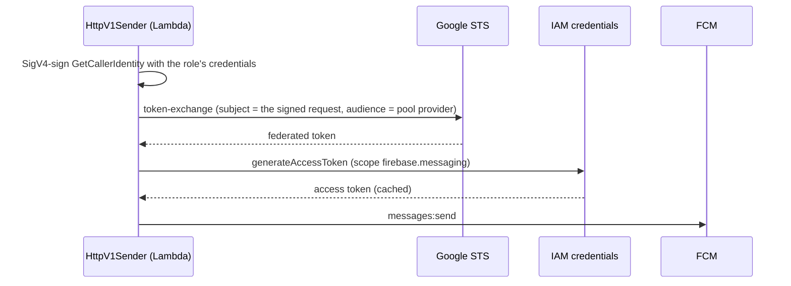

# platform-fcm

The one FCM HTTP v1 sender (shared-rust#2). Shriek, Granite and ChirpAuth each
carried a copy, and only Shriek's set Android priority or reported what became
of a push. This is Shriek's version, extracted.

```rust
use platform_fcm::{Delivery, FcmSender, HttpV1Sender, Message, Notification, Priority};

// At boot. A credential that is set but bad is an Err: refuse to start.
let sender = HttpV1Sender::from_service_account_json(&json)?;
// Or keyless, through Workload Identity Federation from the Lambda's AWS role:
let sender = HttpV1Sender::from_external_account_json(&config, "chirp-push-4821")?;

let message = Message {
    priority: Priority::High(Notification {
        title: "Approval requested".into(),
        body: "Open Granite to review".into(),
        channel_id: Some("approvals".into()), // a channel the app creates
    }),
    data: [("request_id".into(), id)].into(),
    ttl: Duration::from_secs(600),
};
match sender.send(&device.fcm_token, &message).await {
    Delivery::Accepted { message_id } => { /* record it */ }
    Delivery::Unregistered { .. } => { /* drop the device: it never comes back */ }
    Delivery::Failed { reason } => { /* count / audit it */ }
}
```

## The contract

- **Every message names its priority.** FCM's default is NORMAL, which a
  dozing phone holds until its next maintenance window (about 10 minutes).
  `Priority::High` wakes it, and it can only be built with a `Notification`,
  because Android demotes a HIGH message that shows nothing.
  `Priority::Normal(None)` is a data-only message.
- **The caller picks the TTL and channel.** There is no default TTL (FCM's is
  28 days). A `channel_id` lives on the `Notification`, so a data-only message
  cannot name one.
- **`send` returns a `Delivery` and never panics or errors.** `Unregistered`
  (FCM's 404 `UNREGISTERED`) means the token is dead. Everything else that
  did not go out is `Failed` with FCM's status and `errorCode` in the reason.
  Each request is bounded by `REQUEST_TIMEOUT` (10 s). `Delivery` is
  `#[must_use]`.
- **Two credentials, one policy.** Each has one constructor and there is no
  fallback between them. Either fails at boot if it can't be used, and no
  error message carries a value from the JSON or the environment.
  - A service-account key: `ServiceAccount::from_json` loads the RSA key and
    the sender signs an RS256 assertion. It sends to the key's `project_id`.
  - A Google `external_account` config with an AWS subject (shared-rust#38),
    for a Firebase project whose org forbids keys. `ExternalAccount::from_json`
    requires the AWS subject type, `environment_id: aws1`, and a
    `service_account_impersonation_url`. The sender takes the Lambda's role
    credentials and region from `AWS_ACCESS_KEY_ID`, `AWS_SECRET_ACCESS_KEY`,
    `AWS_SESSION_TOKEN` and `AWS_REGION`, read once at construction (the
    config's EC2 metadata URLs are not used). It mints by signing an STS
    `GetCallerIdentity` (SigV4), exchanging it at Google STS (`token_url`) and
    calling `generateAccessToken` on the impersonated service account with the
    FCM scope. The config names no Firebase project, so the caller passes it.
  `NoopSender` is only for a service with no credential named, and every push
  it is handed is `Failed`.
- The OAuth token is cached and minted again within 60 s of expiry.



What stays in each service: which devices, the payload, its channel and TTL,
and what it does with each `Delivery`.

## Testing

The `testkit` feature adds `testkit::FakeFcm`. It is a local server for both
Google endpoints. The token endpoint verifies the RS256 assertion (signature,
`iss`, `aud`, `scope`, expiry). The send endpoint records each message and
answers per device: accepted, `unregister(token)` or `respond(token, status,
body)`. `FakeFcm::sender()` is a real `HttpV1Sender` pointed at it.

For the keyless credential the fake also plays Google STS and
`generateAccessToken`. STS verifies the subject's SigV4 signature against
the fake AWS role's secret, and checks its date, host, session token and pool
provider. `FakeFcm::external_account_sender()` signs as that role, and
`external_account_json()` is its config. The signer itself is checked against
AWS's published test vector, so the fake isn't just checking the signer
against itself.

```toml
[dev-dependencies]
platform-fcm = { git = "https://github.com/stackwell-labs/shared-rust.git", tag = "…", package = "platform-fcm", features = ["testkit"] }
```

`PLATFORM_FCM_KEY_FILE=<service-account.json> cargo test -p platform-fcm`
also mints a real token from Google, and
`PLATFORM_FCM_EXTERNAL_ACCOUNT_FILE=<external_account.json>` (with trusted AWS
role credentials in the `AWS_*` variables) does the same through Workload
Identity Federation. Neither sends anything.
