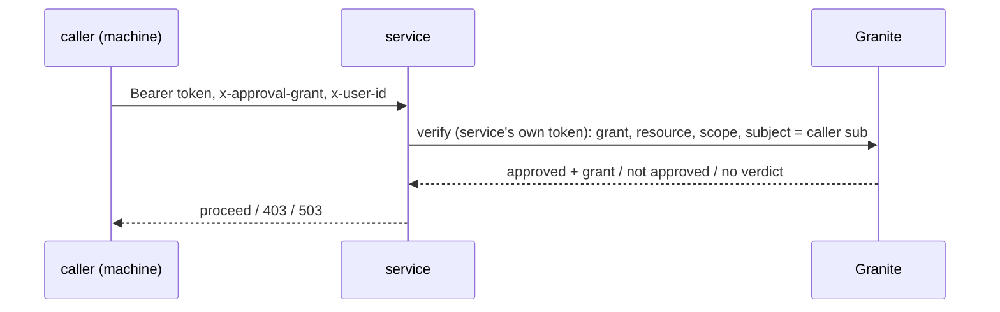

# platform-granite-authz

The one Granite authoriser (shared-rust#21, agent-platform--protocols#47 S1).
"May this caller do that?" is answered by a Granite grant, checked online with
`POST /v1/grants/verify`, so services stop hand-rolling the call and can drop
machine allowlists (`Machines::Allow`/`Dynamic`) for `Machines::Any`.

```rust
use platform_granite_authz::GraniteAuthz;

// At boot. Both are required; a bad URL or service name is an Err.
let authz = GraniteAuthz::new("model-gateway", &granite_url, minter.clone())?;

// Per request, after platform-chirp-auth authenticated the caller.
let ok = authz
    .authorize(&authenticated, &headers, "model-gateway:call", "model.gateway.call")
    .await?; // Refusal -> ApiError: Denied 403, Unavailable 503
act_for(&ok.on_behalf_of, &ok.grant);
```



## The contract

- **The caller** is a machine (`Caller::Machine`): a grant's subject is a
  machine sub today. A person is `Denied::NotAMachine` (person subjects wait on
  granite#82). It names the grant in `x-approval-grant` and the person it acts
  for in `x-user-id`; Granite binds that person to the grant's owner.
- **The answer** is `Authorized { grant, on_behalf_of }`, only when Granite
  approves *and* the grant was minted on the request's plane.
- **Never a 401.** `Denied` (403): no, blank or malformed grant id, no valid
  `x-user-id`, not approved, unknown grant (Granite 404), or another plane.
  `Unavailable` (503): any answer that is no verdict on the grant: Granite
  unreachable, timed out (5 s), 5xx, 429, a 401/403 to the service's own token,
  an undecodable answer, or the service's token failing to mint.
- **Online, no cache.** Each call that reaches the mint/verify step prints one
  CloudWatch EMF line to stdout: namespace `Stackwell/GraniteAuthz`, dimensions
  `[Service, Caller]` (the caller's client id), metrics `VerifyLatency` (ms)
  and `VerifyUnavailable` (0/1; its average is the error rate), plus an
  `Outcome` field. That is 2 custom metrics per (service, caller) pair, about
  $0.60 a month each.
- **The service's own client** must be in Granite's accepted machine audiences
  and, to verify another actor's grant, a grant enforcer
  (`GRANITE_GRANT_ENFORCERS`; an operator grant after granite#81). Without that,
  Granite refuses the service and every call is `Unavailable`, which is the
  service's configuration, not the caller's grant.
- Its own crate, so Granite and ChirpAuth, which use platform-chirp-auth, never
  link code that calls Granite.
