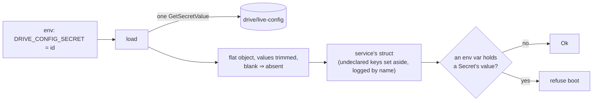

# platform-secrets

The one loader for protocols `docs/adr-secret-storage.md` (shared-rust#4).
A service keeps all its secrets in **one** Secrets Manager secret per plane,
`{service}/live-config` or `{service}/test-config`. That secret is a JSON object
with one `snake_case` key per value, and the service reads it once at cold
start. The Lambda environment carries only the secret's id.

```rust
#[derive(serde::Deserialize)]
struct Secrets {
    control_token: platform_secrets::Secret,          // required
    stripe_secret_key: Option<platform_secrets::Secret>, // absent or blank ⇒ None
}

let secrets: Secrets = platform_secrets::load("DRIVE_CONFIG_SECRET").await?; // refuse boot on Err
```



## The contract

| Case | Result |
|---|---|
| secret-id env var unset or blank, read fails, no `SecretString`, not JSON, not an object | `Err` (refuse boot) |
| a declared key is not a string, or its field's type rejects it | `Err`, naming the key and what the field expected |
| a required key is missing or blank | `Err`, naming the key |
| a value is blank or whitespace | treated as absent, so `Option` gives `None` |
| a key the type does not declare (of any JSON type) | set aside, and logged by name |
| an env var holds the value of a `Secret` field | `Err`, naming the env var and the key |

- **No value is in any error or log line.** Errors can't hold one by
  construction: the crate never runs `serde_json::from_str::<S>`, whose messages
  quote values. JSON syntax errors give a position only, a field's own parse
  message is withheld, and a failed read reports the service's error code, not
  the HTTP response.
- **Every value is a string.** A field that wants a number or URL parses it
  from the string. Unit enums work (`"Enforce"`).
- **`Secret`** has a redacted `Debug`. It has no `Display`, `Serialize` or
  `PartialEq` (compare tokens in constant time), so the value comes out only
  through `expose()`.
- **No env source.** Local runs and tests call `from_file(path)`, which takes a
  JSON copy of the `test-config` under the same contract and logs a warning.
  Nothing switches on "am I in Lambda", and no Cargo feature is involved, so
  no build can read secrets from its environment.

## Moving a service onto it

1. Create the secret (no secret version in Terraform), grant the Lambda role
   `secretsmanager:GetSecretValue` on it, and set the id env var.
2. Copy each value in with `scripts/put-config-key.sh <secret-id> <key>`. The
   value goes on stdin or is typed at the prompt, and the script never
   prints it. `--list` shows the key names.
3. **In one deploy,** ship the code that calls `load` and remove the plaintext
   env vars it replaces. The plaintext-copy check refuses boot if both are
   present.
