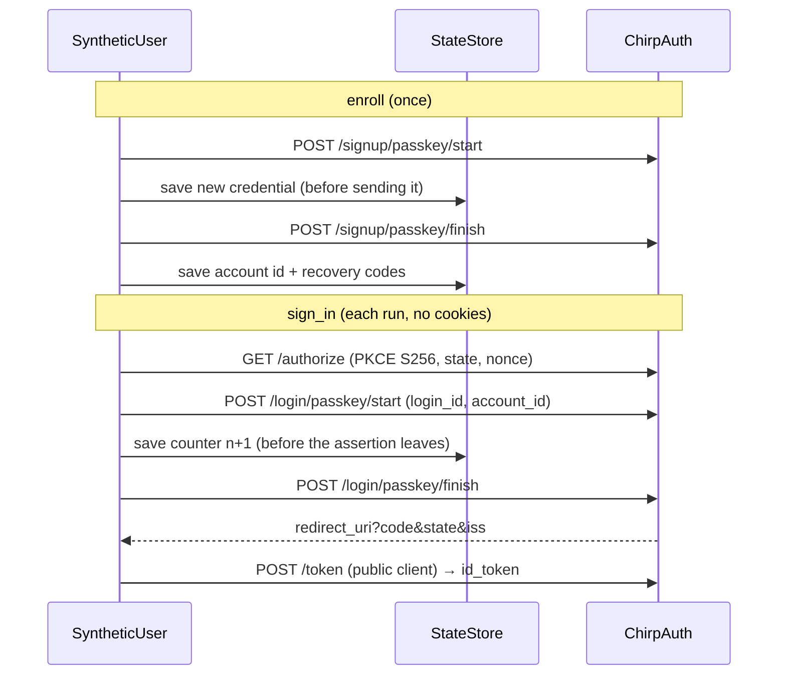
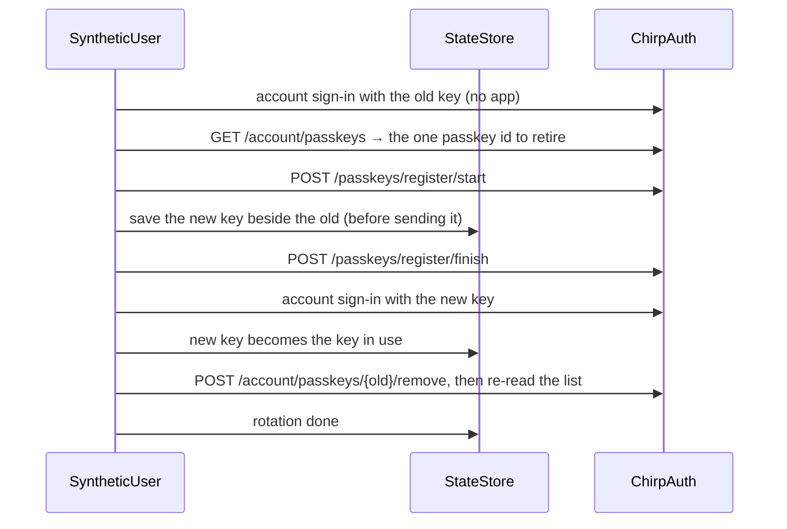
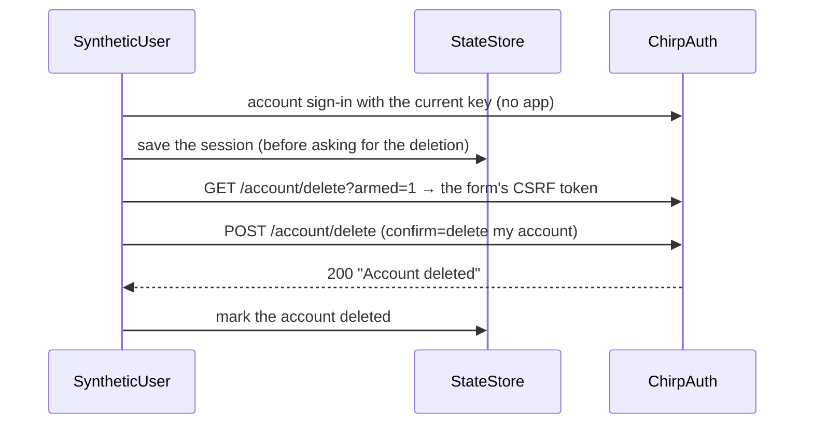

# platform-synthetic-user

A real ChirpAuth account whose passkey is software, so a live check can sign
in to a production relying party with no human. ChirpAuth refuses test tokens
at prod RPs (keyset separation), so a real account is the sanctioned path.
Jot's live check does the same through a browser; this crate does it over
plain HTTP in Rust.



Rotation replaces the key on the same account, so its id, its `sub` at each
app and every grant keyed on it stay put:



Deletion erases the account through the hosted page a person uses, so the
apps it signed in to get ChirpAuth's deletion event for it:



## API

- `Issuer::new(url)`: `https`, or `http` on loopback only.
- `SyntheticUser::enroll(issuer, display_name, store)`: creates the account.
  Refuses a store that already holds a user.
- `SyntheticUser::load(issuer, store)`: never creates an account.
- `user.authorize(&authorize_url)`: completes any `/authorize` URL (yours, or
  a server-side RP's login redirect) and returns the RP callback URL.
- `user.sign_in(&PublicClient)`: the whole public-client flow, returning the
  `id_token` and the `nonce` to check. Verify the token with the RP's verifier.
- `user.sign_in_with_consent(&PublicClient)`: the same, as a returning
  person: a ChirpAuth session first, then the client's `/authorize` in it and
  the "Continue as" click, then sign-out. ChirpAuth grants `chirp.control`
  (its CLI client's scope, which its operator routes require) only this way.
- `user.rotate_passkey()`: a new key on the same account, the old one
  removed. The account must hold exactly one passkey. If it is cut short,
  `state().is_rotating()` is true and calling it again finishes it.
- `user.delete_account()`: erases the account at ChirpAuth, succeeding only on
  its "account deleted" page; the apps the user signed in to get a deletion
  event. ChirpAuth refuses (409) an account that owns apps or has a paid plan.
  If it is cut short, `state().is_deleting()` is true, every other flow
  refuses, and calling it again finishes it through the saved session, with
  no new sign-in (ChirpAuth makes no new session for an account it is
  deleting). Afterwards `state().is_deleted()` is true and `load` refuses the
  store. If the deletion committed but its answer was lost, the saved session
  is gone with the account, so the retry's fresh sign-in is refused
  ("passkey unavailable"): ChirpAuth doesn't say which account ids exist.
- `StateStore` (`load`, `save`); `FileStore` writes atomically with mode 0600.

## Guarantees

- **Counter is write-ahead.** An assertion is released only after the counter
  it carries is saved, so a failure, a refusal or a crash never leaves the
  stored counter behind the issuer's. A failed save sends nothing.
- **Rotation never strands the account.** The new key is saved beside the
  old before its registration is sent, and replaces it in the store only
  after ChirpAuth accepts a sign-in from it; the old passkey is removed last.
  A rotation cut short at any save resumes from the store. A state saved
  mid-rotation can't be read by a version before 0.2.0 (it refuses loudly).
- **Deletion never strands the account.** The session that asks for the
  deletion is saved before the request, since once ChirpAuth records the
  deletion only that session can finish it. A state saved mid-deletion or
  after it can't be read by a version before 0.4.0 (it refuses loudly).
- **rpId is the issuer's exact host**, as ChirpAuth derives it; anything
  else is refused, like a browser would.
- **Only public flows.** The same requests the hosted signup and sign-in
  pages make. No control token, outbox or test bypass.

The authenticator is one small module on `p256`: one ES256 key, `none`
attestation, UP+UV. `passkey-rs` (1Password) fits functionally but its
`Passkey` is not serializable and it pulls `mockall`, `tokio` and transport
crates in as normal dependencies; `webauthn-authenticator-rs` is MPL-2.0,
needs OpenSSL, and its `SoftPasskey` can do neither resident keys nor user
handles (chirp-auth's own tests note this).

## Local proof

`tests/local_issuer.rs` runs against chirp-auth's local issuer: enroll, sign
in, verify the `id_token` on the local JWKS with `chirp-auth-client`, sign in
again for the same `sub`, and show a stale copy of the state (a repeated
counter) refused while the genuine state still signs in. It also rotates the
key (same `sub` after, old key refused, a second rotation works), and cuts a
rotation short after each of its five saves and resumes it. It deletes an
account that signed in to a client: the store is refused afterwards, a copy of
the old state can't sign in, and the client has a deletion event for the
user's `sub` (`GET /control/apps/deletion-events`). A deletion cut short after
its session is saved resumes through that session (the counter doesn't move);
a saved session ChirpAuth no longer knows is replaced by a fresh sign-in.
ChirpAuth's local issuer has no fault injection, so a deletion that fails
inside ChirpAuth part way is not exercised here; its resume is ChirpAuth's own
(`docs/account-deletion.md`).

The rotation finds the passkey to remove on the hosted passkey list page
(its remove links), the only listing a session can read; a change to that
page's links fails the rotation loudly, here and in CI.

```sh
# in a chirpauth/server-dev checkout
cargo build --bin chirp-service --features local-serve
# here
CHIRP_AUTH_SERVICE_BIN=/path/to/target/debug/chirp-service \
  cargo test -p platform-synthetic-user -- --include-ignored --nocapture
```

CI runs the same in `.github/workflows/synthetic-user.yml`, against a pinned
chirp-auth revision.
