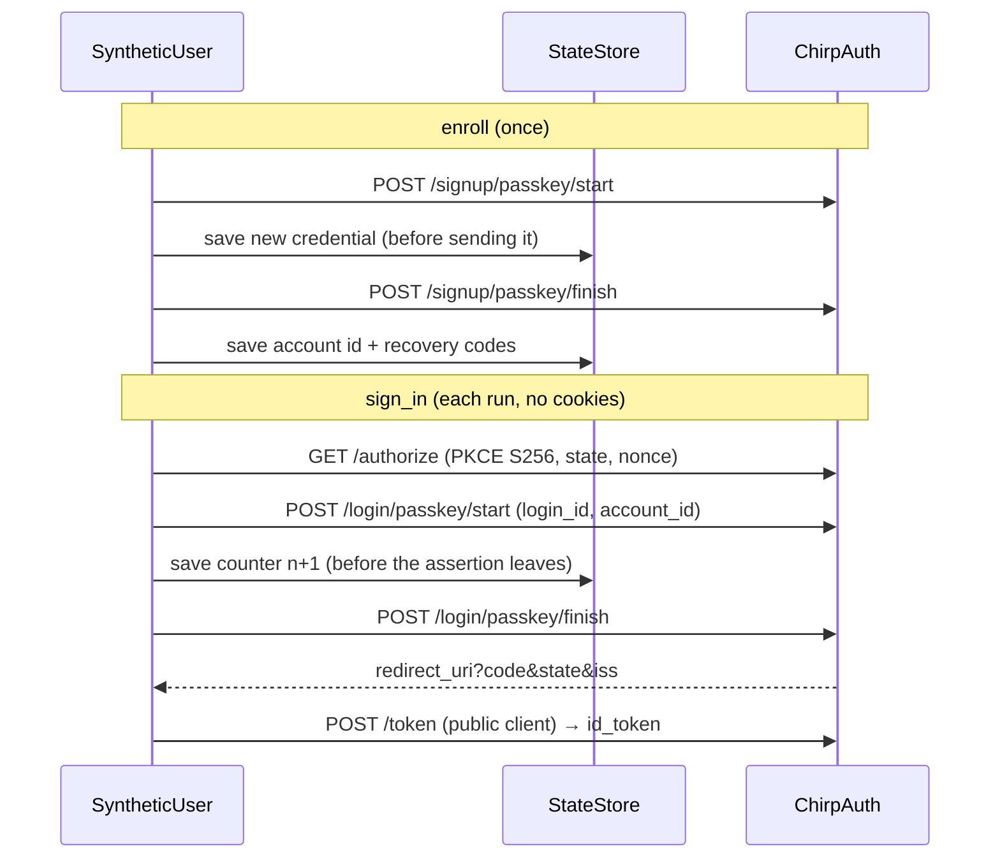

# platform-synthetic-user

A real ChirpAuth account whose passkey is software, so a live check can sign
in to a production relying party with no human. ChirpAuth refuses test tokens
at prod RPs (keyset separation), so a real account is the sanctioned path.
Jot's live check does the same through a browser; this crate does it over
plain HTTP in Rust.



## API

- `Issuer::new(url)`: `https`, or `http` on loopback only.
- `SyntheticUser::enroll(issuer, display_name, store)`: creates the account.
  Refuses a store that already holds a user.
- `SyntheticUser::load(issuer, store)`: never creates an account.
- `user.authorize(&authorize_url)`: completes any `/authorize` URL (yours, or
  a server-side RP's login redirect) and returns the RP callback URL.
- `user.sign_in(&PublicClient)`: the whole public-client flow, returning the
  `id_token` and the `nonce` to check. Verify the token with the RP's verifier.
- `StateStore` (`load`, `save`); `FileStore` writes atomically with mode 0600.

## Guarantees

- **Counter is write-ahead.** An assertion is released only after the counter
  it carries is saved, so a failure, a refusal or a crash never leaves the
  stored counter behind the issuer's. A failed save sends nothing.
- **rpId is the issuer's exact host**, as ChirpAuth derives it; anything
  else is refused, like a browser would.
- **Only public flows.** The same requests the hosted signup and sign-in
  pages make. No control token, outbox or test bypass.

The authenticator is one small module on `p256`: one ES256 key, `none`
attestation, UP+UV. `passkey-rs` (1Password) fits functionally but its
`Passkey` is not serializable and it pulls `mockall`, `tokio` and transport
crates in as normal dependencies; `webauthn-authenticator-rs` is MPL-2.0,
needs OpenSSL, and its `SoftPasskey` can do neither resident keys nor user
handles (chirp-auth's own tests note this).

## Local proof

`tests/local_issuer.rs` runs against chirp-auth's local issuer: enroll, sign
in, verify the `id_token` on the local JWKS with `chirp-auth-client`, sign in
again for the same `sub`, and show a stale copy of the state (a repeated
counter) refused while the genuine state still signs in.

```sh
# in a chirpauth/server-dev checkout
cargo build --bin chirp-service --features local-serve
# here
CHIRP_AUTH_SERVICE_BIN=/path/to/target/debug/chirp-service \
  cargo test -p platform-synthetic-user -- --include-ignored --nocapture
```

CI runs the same in `.github/workflows/synthetic-user.yml`, against a pinned
chirp-auth revision.
